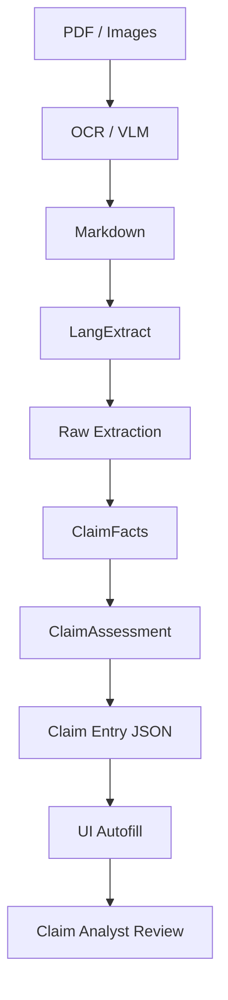

# Medical Claim Intelligence Platform
## Architecture, PRD, Development Guide & Engineering Rules

STATUS: Source of Truth

Purpose:

Dokumen ini menjelaskan:

- tujuan sistem
- arsitektur
- flow data
- role setiap layer
- rulebook
- output structure
- developer workflow
- maintainability principles

Dokumen ini harus menjadi referensi utama sebelum melakukan perubahan besar pada codebase.

---

# BUSINESS GOAL

Membangun Medical Claim Intelligence System yang mampu:

- memahami dokumen medis
- memahami dokumen klaim
- memahami hubungan diagnosis dan terapi
- memahami rawat inap dan rawat jalan
- memahami claim luar negeri
- membantu analyst claim entry
- menghasilkan autofill claim entry
- memberikan confidence dan reasoning

Tujuan sistem bukan sekadar OCR atau extraction.

Tujuan sistem adalah:

Medical Claim Understanding

---

# CURRENT HIGH LEVEL FLOW

PDF / Images
↓
OCR (Docling / MinerU)
↓
Markdown
↓
LangExtract
↓
ClaimFacts
↓
ClaimAssessment
↓
Claim Entry JSON
↓
UI Autofill

---

# CORE PRINCIPLES

## Principle 1

Claim Entry UI adalah kontrak utama.

Output JSON harus mengikuti field yang sudah ada pada aplikasi claim entry.

Jangan membuat field generic baru jika field UI sudah tersedia.

GOOD

```json
{
  "insuredName": "John Doe"
}
```

BAD

```json
{
  "patient_name": "John Doe"
}
```

---

## Principle 2

Rulebook adalah sumber kebenaran tunggal.

Semua business rules harus berasal dari:

```text
schemas/claim_rulebook.py
```

Rulebook digunakan untuk:

- Prompt generation
- Validation
- Rule documentation
- Reasoning guidance
- Assessment guidance

---

## Principle 3

Assessment tidak membaca markdown.

SALAH

```text
Markdown
↓
Assessment
```

BENAR

```text
Markdown
↓
ClaimFacts
↓
Assessment
```

---

## Principle 4

Semua keputusan wajib explainable.

Setiap decision wajib memiliki:

- value
- confidence
- reason
- evidence

Contoh:

```json
{
  "isRI": {
    "value": true,
    "confidence": 95,
    "reason": "Admission and discharge dates detected",
    "evidence": [
      "medical_resume",
      "admission_date",
      "discharge_date"
    ]
  }
}
```

---

# WHY LANGEXTRACT

Project ini membutuhkan:

- auditability
- provenance
- evidence tracking
- long document handling
- chunking
- multiple extraction pass
- confidence reasoning

Karena itu LangExtract tetap menjadi extraction engine utama.

Tugas LangExtract:

```text
Markdown
↓
ClaimFacts
```

Bukan:

```text
Markdown
↓
Claim Entry JSON
```

---

# ARCHITECTURE

## Stage 1

OCR Layer

Input:

```text
PDF
Image
```

Output:

```text
Markdown
```

Responsibility:

- OCR
- Layout understanding
- Table extraction

Tidak boleh:

- menentukan RI
- menentukan RJ
- menentukan claim type

---

## Stage 2

Fact Extraction Layer

Input:

```text
Markdown
```

Output:

```python
ClaimFacts
```

Responsibility:

- identify entities
- normalize data
- merge documents
- build factual view

Tidak boleh melakukan keputusan bisnis.

---

## Stage 3

Assessment Layer

Input:

```python
ClaimFacts
```

Output:

```python
ClaimAssessment
```

Responsibility:

- RI/RJ
- Overseas
- New Claim
- Kelengkapan
- Review (SP4)
- Possible New Claim
- Medical Assessment

---

## Stage 4

Claim Entry JSON

Input:

```python
ClaimFacts
ClaimAssessment
```

Output:

```json
{
  "header": {},
  "memberInfo": {},
  "serviceLines": [],
  "decisions": {},
  "usage": {}
}
```

Tujuan:

Autofill UI.

---

# JSON LAYERS

## Layer 1

Raw Extraction

Purpose:

Fakta mentah.

Contoh:

```json
{
  "provider_names": [],
  "doctor_names": [],
  "diagnoses": [],
  "documents": [],
  "dates": [],
  "medications": [],
  "financials": []
}
```

Tidak ada business logic.

---

## Layer 2

ClaimFacts

Purpose:

Canonical Contract.

Semua reasoning membaca layer ini.

Contoh:

```json
{
  "insuredName": "",
  "policyHolderName": "",

  "providerNames": [],
  "doctorNames": [],

  "documentTypes": [],

  "diagnoses": [],
  "medications": [],

  "visitDates": [],

  "currency": "",
  "amountIncurred": 0
}
```

Factual Layer.

---

## Layer 3

ClaimAssessment

Purpose:

Decision Layer.

Contoh:

```json
{
  "isRI": {},
  "isRJ": {},
  "isOverseas": {},
  "isNewClaim": {},
  "isKelengkapan": {},
  "possibleNewClaim": {}
}
```

Assessment membaca:

```text
ClaimFacts
+
ClaimRulebook
```

bukan markdown.

---

## Layer 4

Claim Entry JSON

Purpose:

UI Contract.

Output final harus mengikuti field UI.

---

# CLAIM ENTRY JSON STRUCTURE

## Header

Gunakan field asli editForm.

Contoh:

```json
{
  "header": {
    "insuredName": "",
    "accountNo": "",
    "accountName": "",

    "typeOfVisit": "",

    "visitFrmDtm": "",
    "visitToDtm": "",

    "noOfDays": 0,

    "hphpName": "",
    "hphpId": "",

    "hpspNames": [],

    "reasonOfVists": "",

    "icdCode1": "",
    "icdCode2": "",

    "incuredAmt": 0,

    "sysvCurrencyType": "",

    "exchangeRate": 1,

    "invoiceNo": "",

    "internalRemark": ""
  }
}
```

---

## MemberInfo

```json
{
  "memberInfo": {
    "policyHolder": "",
    "effectiveDate": "",
    "policyAge": "",
    "effectiveRider": "",
    "rideAge": ""
  }
}
```

---

## ServiceLines

```json
{
  "serviceLines": [
    {
      "serviceDateFrom": "",
      "serviceDateTo": "",
      "serviceProcedureCode": "",
      "serviceProcedureDesc": "",
      "incurredAmount": 0
    }
  ]
}
```

---

## Decisions

```json
{
  "decisions": {

    "isRI": {},

    "isRJ": {},

    "isOverseas": {},

    "isNewClaim": {},

    "isKelengkapan": {},

    "possibleNewClaim": {}

  }
}
```

---

# DECISION OBJECT STANDARD

Semua keputusan harus menggunakan format yang sama.

```json
{
  "value": true,
  "confidence": 95,
  "method": "rulebook",
  "reason": "",
  "evidence": []
}
```

---

# RULEBOOK DRIVEN DEVELOPMENT

Single Source of Truth:

```python
ClaimRulebook
```

Rulebook saat ini didefinisikan di ``schemas/claim_rulebook.py``. Jenis rules
yang sudah ada:

```python
VisitRules
ClaimTypeRule
OverseasRule
PeriodRules
NameCheckRule
DocumentRules
ConfidenceTier
```

Jangan menambah tabel default kedua di service. Service membaca nilai dari
``DEFAULT_RULEBOOK`` atau menerima instance rulebook secara eksplisit.

---

# PROMPT STRATEGY

DILARANG:

```python
prompt = """
500 lines
"""
```

WAJIB:

```python
build_prompt(rulebook)
```

Prompt harus dibangkitkan otomatis dari Rulebook.

Developer tidak mengedit prompt manual.

---

# LARGE DOCUMENT STRATEGY

Markdown akan terus membesar.

Contoh:

```text
20 pages
100 pages
300 pages
500 pages
```

Karena itu:

```text
Markdown
↓
ClaimFacts
↓
Assessment
```

harus selalu dipertahankan.

Assessment tidak boleh membaca markdown mentah.

---

# PARENT PRUNING RULE

Parent kosong harus dihapus.

GOOD

```json
{
  "memberInfo": {
    "policyHolder": "John Doe"
  }
}
```

BAD

```json
{
  "memberInfo": {},
  "providerInfo": {},
  "medicalInfo": {}
}
```

---

# AUTOFILL RULE

Claim Entry JSON harus cocok dengan field UI.

Contoh:

```text
insuredName
visitFrmDtm
visitToDtm
hphpName
hpspNames
reasonOfVists
icdCode1
incuredAmt
sysvCurrencyType
```

Frontend harus dapat melakukan:

```javascript
$('#insuredName').val(...)
$('#visitFrmDtm').val(...)
$('#hphpName').val(...)
```

tanpa mapper tambahan.

---

# ADDING NEW REQUIREMENTS

Developer harus mengkategorikan kebutuhan.

## New Fact

Contoh:

```text
Passport Number
```

Di implementasi sekarang, registry extraction berada di
``services/claim_fields.py``. Tambahkan ``FieldSpec`` ke ``FIELD_SPECS``:

```python
FieldSpec(
    name="passport_number",
    kind="scalar",
    field_type="identifier",
    family="identity",
    description="Nomor paspor tertanggung.",
)
```

Pilih ``kind`` sesuai bentuk fakta:

- ``scalar``: satu nilai kanonis, misalnya nomor polis.
- ``list``: banyak nilai; wajib punya ``list_destination``.
- ``group``: record relasional, misalnya obat + dosis + frekuensi; daftarkan
  relasinya di ``GROUP_DEFINITIONS``.
- ``derived``: bukan output LangExtract; hitung di assessment/normalization.

Field yang ambigu perlu ``description`` agar maknanya masuk ke prompt/schema
extraction. Registry menghasilkan allowlist extraction, field normalisasi,
family, dan tujuan list; jangan membuat daftar duplikat di service lain.

Jika field harus tersedia di ClaimFacts canonical atau output UI, lanjutkan ke
bagian **Final Output Schema**. Field extraction tidak otomatis menjadi field
UI.

---

## New Rule

Contoh:

```text
New Overseas Logic
```

1. Tambahkan atau ubah model/default rule di ``schemas/claim_rulebook.py``.
2. Gunakan rule tersebut dari ``services/claim_rules.py`` atau
   ``services/assessment_service.py``; jangan copy nilai default ke service.
3. Bila rule perlu masuk prompt, tambahkan representasinya ke
   ``rulebook_prompt_section()``. Prompt tetap dibangun oleh
   ``build_prompt(rulebook)``.
4. Tambahkan tes untuk default rule dan rulebook kustom.

Contoh perubahan label claim type:

```python
ClaimTypeRule(
  value="review",
  labels=["tinjau ulang", "review", "sp4"],
)
```

Tes sebaiknya membuktikan bahwa service mengikuti konfigurasi, bukan konstanta
lokal:

```python
custom_rulebook = ClaimRulebook(
  claim_types=[ClaimTypeRule(value="review", labels=["manual audit"])]
)
assert canonical_claim_case_type("Manual Audit", custom_rulebook)[0] == "review"
```

---

## New Decision

Contoh:

```text
isAccidentClaim
```

Decision dihitung dari facts dan rulebook, bukan dari Markdown. Pada implementasi
saat ini:

```text
Rule/schema: schemas/claim_rulebook.py, schemas/claim_pipeline.py
Logic:       services/assessment_service.py
Contract:    analyst_analysis pada ClaimContract
```

Setiap decision membawa nilai, confidence, method, reason, dan evidence. Bila
decision baru mengubah kontrak, update model/schema dan tes payload-nya juga.
``ClaimAssessment`` terpisah masih merupakan target arsitektur; kontrak runtime
saat ini bernama ``AnalystAnalysis``.

---

## New UI Field

Contoh:

```text
passportNo
```

Pastikan nama field sama persis dengan ``id``/``name`` pada editForm. Mapper
grouped yang dipakai sekarang adalah ``build_grouped_claim_form()`` di
``services/claim_form.py``. Tambahkan mapping di parent yang tepat:

```text
memberInfo / header / policyInfo / serviceLines
```

Jangan mengirim nama extraction snake_case sebagai pengganti nama UI. Tambahkan
tes di ``tests/test_claim_form.py`` untuk nama field, nilai sumber, dan pruning
parent kosong.

---

# FINAL OUTPUT SCHEMA

## Output Runtime Saat Ini

Grouped final JSON dibuat oleh ``build_grouped_claim_form()``. Bentuk aktualnya
adalah:

```json
{
  "schema_version": "claim-full-v2",
  "isNewClaim": false,
  "isKelengkapan": false,
  "isRI": false,
  "isRJ": true,
  "isOverseas": false,
  "possibleNewClaim": false,
  "decisions": {
    "visitType": {
      "value": "outpatient",
      "confidence": 100,
      "method": "explicit_document_value",
      "reason": "Rawat Jalan tertulis pada dokumen",
      "evidence": ["Rawat Jalan"]
    }
  },
  "memberInfo": {
    "insuredName": "Jane Doe",
    "clientNo": "MBR-001"
  },
  "header": {
    "typeOfVisit": "outpatient",
    "visitFrmDtm": "2026-09-10",
    "visitToDtm": "2026-09-10",
    "hphpName": "Example Hospital",
    "reasonOfVists": "Rawat jalan untuk konsultasi",
    "sysvCurrencyType": "IDR",
    "incuredAmt": 1250000
  },
  "serviceLines": [
    {
      "serviceDateFrom": "2026-09-10",
      "serviceDateTo": "2026-09-10",
      "spspId": "CONSULT",
      "incuredAmt": 1250000
    }
  ],
  "usage": {}
}
```

``memberInfo``, ``header``, ``policyInfo``, ``serviceLines``, ``decisions``,
``provenance``, ``review``, dan ``usage`` dapat tidak muncul bila tidak ada
nilainya. Parent kosong wajib di-prune. Field flag di root saat ini berupa
boolean; detail explainability berada di ``decisions``.

**Penting:** grouped output saat ini dibentuk oleh Python builder dan dites,
belum divalidasi oleh Pydantic ``ClaimEntryPayload`` atau JSON Schema final
tersendiri. Contoh di atas mendokumentasikan runtime contract, bukan model yang
sudah digenerate otomatis.

## Mengubah Final Output

Untuk menambahkan atau mengubah field output:

1. Pastikan field dan maknanya memang ada pada Claim Entry UI.
2. Pastikan sumbernya tersedia di ClaimFacts/ClaimContract. Jangan membuat fakta
   dari assessment atau mengisi fakta dokumen dengan default tanpa menandai
   statusnya.
3. Tambahkan mapping ke parent dan nama UI yang tepat di
   ``services/claim_form.py`` pada ``build_grouped_claim_form()``.
4. Pertahankan pruning parent kosong dan format decision yang explainable.
5. Tambahkan tes shape/value di ``tests/test_claim_form.py``. Jika kontrak formal
   Pydantic/JSON Schema ditambahkan, validasi output builder terhadap schema itu.
6. Jalankan seluruh tes:

```powershell
.\.venv\Scripts\python.exe -m unittest discover -s tests -q
```

Perubahan nama atau tipe field adalah perubahan kontrak UI: perbarui consumer
autofill dan tes dalam perubahan yang sama.

## Peta Source Of Truth Saat Ini

| Perubahan | Satu pintu saat ini | Tes utama |
|---|---|---|
| Field extraction | ``services/claim_fields.py``: ``FIELD_SPECS`` | ``tests/test_langextract_service.py`` |
| Relasi/group extraction | ``services/claim_fields.py``: ``GROUP_DEFINITIONS`` | ``tests/test_langextract_service.py`` |
| Business rule | ``schemas/claim_rulebook.py`` | ``tests/test_claim_form.py`` |
| Assessment | ``services/assessment_service.py`` + ``schemas/claim_pipeline.py`` | ``tests/test_langextract_service.py`` |
| Claim Entry mapping | ``services/claim_form.py``: ``build_grouped_claim_form`` | ``tests/test_claim_form.py`` |

``services/claim_entry_mapper.py`` dan schema Pydantic final merupakan target
pemisahan berikutnya, belum file runtime yang tersedia. Jangan menambahkan
duplikasi mapping/rule sambil menunggu pemisahan tersebut.

---

# TARGET FOLDER STRUCTURE

```text
schemas/

    claim_rulebook.py

    claim_facts.py

    claim_assessment.py

services/

    langextract_service.py

    assessment_service.py

    claim_entry_mapper.py

tests/

    test_rulebook.py

    test_assessment.py

docs/

    ARCHITECTURE_AND_PRD.md
```

---

# DEVELOPER CHEAT SHEET

Need New Fact?
→ ClaimFacts

Need New Rule?
→ ClaimRulebook

Need New Decision?
→ ClaimAssessment

Need New UI Field?
→ Claim Entry Mapper

Need New Test?
→ tests/

---

# MERMAID



---

# GOLDEN RULES

Rulebook = Business Knowledge

ClaimFacts = Factual Knowledge

ClaimAssessment = Decision Knowledge

Claim Entry JSON = UI Contract

Assessment membaca ClaimFacts, bukan markdown.

Setiap decision wajib memiliki:
- value
- confidence
- reason
- evidence

Menambah feature baru idealnya hanya menyentuh:
- Rulebook
- Schema
- Test

Mission:

Maintainability > Clever Code